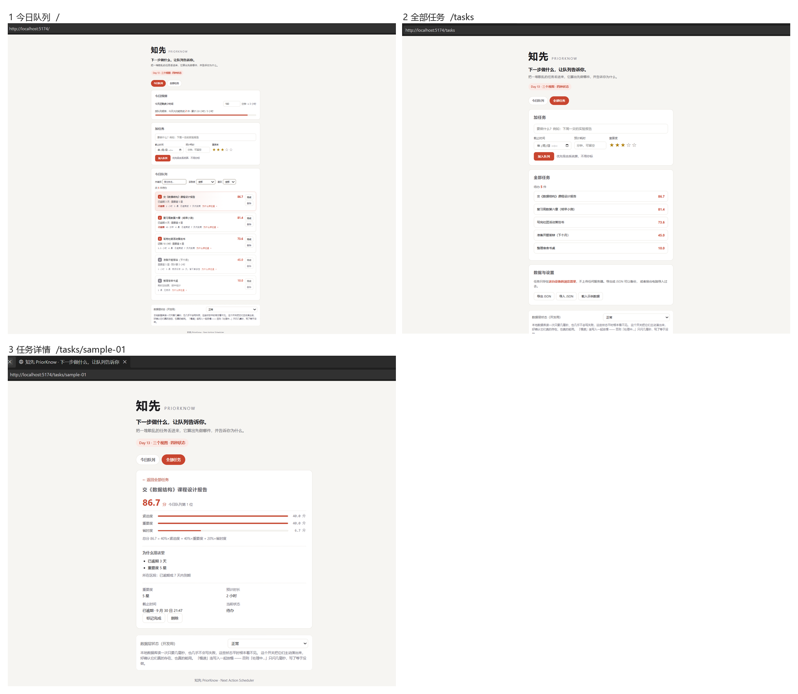
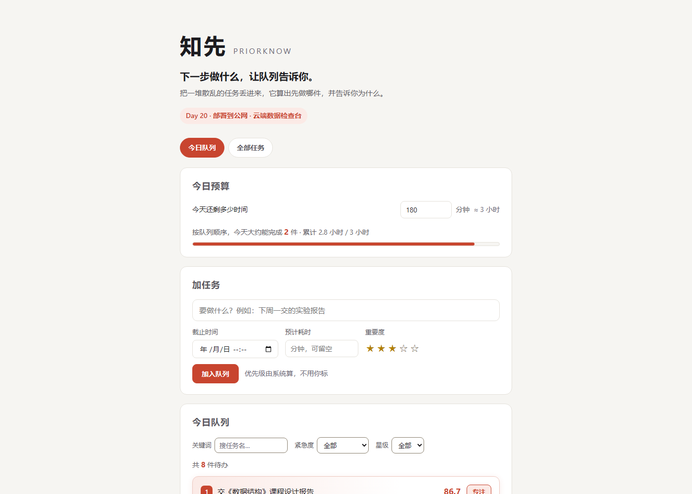

# 知先 PriorKnow

> **别问先做什么，知先告诉你现在做什么。**
> *Next Action Scheduler — Know what to do now.*

把一堆散乱的任务丢进来，它算出先做哪件，**并告诉你为什么是它**。

普通待办工具负责「记下来」，知先回答那个更难的问题：**我现在最该做什么？**

[](docs/)
[](app/package.json)
[](docs/规格/cloud-notes.md)

---

## 目录

- [这是什么](#这是什么)
- [给谁用](#给谁用)
- [现在能干什么](#现在能干什么)
- [核心机制：可解释的自动排序](#核心机制可解释的自动排序)
- [跑起来](#跑起来)
- [线上地址](#线上地址)
- [技术架构](#技术架构)
- [仓库结构](#仓库结构)
- [进度](#进度)
- [文档](#文档)
- [已知限制](#已知限制)

---

## 这是什么

**知先（PriorKnow）是一个以动态优先队列为核心的「下一个最优行动调度器」。**

它不是清单，是队列。清单回答「我有什么」，队列回答「下一个是什么」。

三件事撑起整个产品：

| | 做法 |
| --- | --- |
| **自动算优先级** | 不让你手动标 P1/P2 —— 系统按任务的截止时间、重要度、预计耗时算分 |
| **队列看得见** | 任务顺序呈现为一条队列，任何参数一变当场重排，不是刷新后才更新 |
| **理由说得出** | 每个排在前面的任务都写着「为什么是它」，**不是黑盒** |

<p align="center">
  
</p>

<p align="center"><sub>三个视图：今日队列（<code>/</code>）、全部任务管理（<code>/tasks</code>）、任务详情与三因子明细（<code>/tasks/:id</code>）</sub></p>

---

## 给谁用

| 人群 | 典型场景 | 现有工具的痛点 |
| --- | --- | --- |
| **期末周学生**（首要） | 多门作业、实验报告、考试复习同时压着 | 清单很长，但不知道该先复习哪科 |
| **备考人群** | 长期目标已拆成日常任务 | 每天对着列表发呆，先挑简单的做 |
| **多任务工作者** | 需求、会议、文档、沟通交织 | 一天被切碎，重要的事一拖再拖 |

**共性**：不是「没有工具记录」，而是「工具不能替我决定」。

一个真实场景 —— 周五晚上压着 8 件事，你明知报告要紧，却总忍不住先去做十分钟能划掉的杂事。知先的做法是：输入「今天还剩 3 小时」，得到一条**只装得下**的队列，报告排第一，理由写着「明天截止 + 重要度 5 星 + 需要 2 小时 → 今天不做就来不及」。

---

## 现在能干什么

### ✅ 已经能用

| 能力 | 说明 |
| --- | --- |
| **加任务** | 标题 / 截止时间 / 预计耗时 / 重要度 1–5 星 |
| **自动算分排序** | 三因子加权，0–100 分，队列实时重排 |
| **重排动画** | 完成 / 撤销 / 新增 / 删除之后，卡片上下浮动到新位置，不是硬跳 |
| **可解释排序** | 每个任务显示分数 + 「为什么是它」的人话理由 + 三因子逐项明细 |
| **今日时间预算** | 填「今天还剩几小时」，只选出装得下的一组任务 |
| **三个视图** | 今日队列 / 全部任务管理 / 任务详情 |
| **关键词与筛选** | 按关键词、紧急度、星级筛 |
| **完成 / 撤销 / 删除 / 恢复** | 行内操作，操作后给提示条而不是整页报错 |
| **专注模式** | 点队首卡片的「专注」→ 只剩这一件 + 按预计耗时倒计时；点完成，下一件自动浮上来 |
| **数据导出 / 导入** | JSON 一键带走，换设备不丢东西 |
| **离线可用** | 数据存浏览器 IndexedDB，断网照常用 |
| **失败说得清** | 错误分五类（输入 / 网络 / 服务端 / 本机数据 / 未预料），每条都说「发生了什么 + 你怎么做」，不甩英文原文 |
| **写失败不换页** | 改、删、完成失败只在顶部出一条提示条，**手上原有的数据不会消失**，可以重试 |
| **界面状态齐全** | 加载中 / 读取失败 / 空 / 正常 / 写失败提示，读取失败可重试 |
| **窄屏适配** | 手机 375px 零横向滚动，键盘操作有可见焦点环 |

### ⏳ 还没做（诚实列出来）

| 能力 | 状态 |
| --- | --- |
| **云端多设备同步** | 接口已全部落地（增量拉取 `GET ?since=N`、批量推送 `POST`、单条改 `PATCH` / 单条删 `DELETE`，Day 22 补齐）；前端已能「推送本机任务 / 按游标拉取 / 单条写回」，**数据层默认仍走本机库** —— 真正的双向合并排在后面 |
| **账号登录** | 接口侧目前**没有身份认证**（`X-User-Id` 由客户端自报）。登录用 CloudBase 内置认证，排在 Day 25 之后 |
| **回收站** | 数据模型已留 `deleted_at` / `purged_at`，界面未做 |
| 自然语言加任务 | 未做（总纲里列为可选增强） |
| 决策模拟 / 分享卡片 | 总纲里的设想，**本期未纳入** |

> 完整范围与不做的事，看 [`docs/规格/PRD.md`](docs/规格/PRD.md)。

---

## 核心机制：可解释的自动排序

这是本项目唯一「算法味」的部分，也是它和普通待办工具的分界线。

### 三因子加权，0–100 分

```
分数 = 100 × (0.40 × 紧迫度 + 0.40 × 重要度 + 0.20 × 省时度)
```

| 因子 | 怎么算 | 为什么这么定 |
| --- | --- | --- |
| **紧迫度** | 逾期 = 1；否则 `1 − 剩余天数 ÷ 7`；无期限或 7 天外 = 0 | 一周是人的规划周期 —— 超过一周的事，现在焦虑也没用 |
| **重要度** | `(星级 − 1) ÷ 4` | 1 星记 0、5 星记 1 |
| **省时度** | `1 ÷ (1 + 分钟 ÷ 60)` | 用平滑曲线而非分段，避免「15 分钟满分、16 分钟掉一大截」的断层 |

**权重集中在一个文件里**（`app/src/core/priority.ts`），调参只改这一处。

### 分段排：先看急不急，再看分高低

光比分数会出问题 —— 一件「16.7 分但明天截止」的任务会排到「50 分但不急」后面。所以队列分两段：

```
第一段：紧迫度 > 0（已逾期或 7 天内到期）—— 内部按分数排
第二段：其余（7 天外的 + 没填期限的）—— 同等对待，一起按分数排
```

⚠️ 判据是**紧迫度 > 0**，不是「有没有填截止时间」。用后者会让「6 个月后才交、重要性不高」的任务（公式已认定它不紧急）插到「很重要但没设期限」的前面 —— 同一个系统里两处判断打架。现在算分和分段共用同一个 `urgencyOf()`，只有一个真相来源。

### 二叉堆维护队列

新任务插入 → 上浮；参数变了 → 下沉。`app/src/core/priorityQueue.ts`（241 行）实现，**核心层不依赖 React**，所以算法能独立测试、也能原样搬到小程序或 App。

### 派生值一律不入库

分数、重要度、省时度都是**算出来的**，不存进数据库。原因很直接：权重一调，存下来的分数全过期。实时算，界面上的分数永远和当前公式一致。

---

## 跑起来

需要 **Node.js `^20.19.0` 或 `>=22.12.0`**（这是 Vite 8.3 的 `engines` 要求；低于它会直接报引擎不匹配，Node 18 完全跑不了）。

```bash
git clone https://github.com/XingHo-VibeCoding/PriorKnow.git
cd PriorKnow/app
npm install
npm run dev
```

看到 `Local: http://localhost:5173/` 就成功了，浏览器打开该地址。

| 命令 | 作用 |
| --- | --- |
| `npm run dev` | 启动开发服务器（改代码自动刷新） |
| `npm run typecheck` | 只做 TypeScript 类型检查 |
| `npm run build` | 类型检查 + 打包到 `dist/` |
| `npm run preview` | 本地预览打包结果 |

> ⚠️ 端口被占用时会静默顺延，`5173` 不通不代表出错 —— 看输出里 `Local:` 那行的实际端口。要固定端口加 `--port 5173 --strictPort`。

**打开后先点「载入示例数据」** —— 里面是 7 条「期末周冲刺」场景的任务，30 秒能看懂产品在干什么。

**想看「加载中」和「读取失败」两种状态**：在「数据与设置」最下面有个 **数据层状态（开发用）** 下拉框，切到「模拟慢速读取」或「模拟读取失败」。本地库读一次只要几毫秒，不主动演一下这两种状态永远没人见过。

运行说明与踩过的坑在 [`app/README.md`](app/README.md)。

---

## 线上地址

| 是什么 | 地址 |
| --- | --- |
| **前端**（CloudBase 静态托管） | `https://priorknow-d0go4uh2uc0f62465-1489177462.tcloudbaseapp.com/` |
| **云函数**（`/api/tasks`） | `https://priorknow-d0go4uh2uc0f62465.service.tcloudbase.com/api/tasks` |

<p align="center">
  
</p>

**打开之后要看到数据，走这两步**（Day 20）：
1. 首次访问会先过腾讯云的「访问提示」中间页 —— 点「确定访问」即可（点一次，之后有 Cookie 不再弹）。
2. 进「全部任务」→「云端同步」，填接口地址（上面那个 `/api`，**不带 `/tasks`**）和用户编号 `demo-user-001`，点「按游标拉取」。拉到的东西会**落到本机**，回「今日队列」就能看到。

⚠️ 数据以**各自浏览器**为准（本地优先设计），云端只存副本。所以换一台干净电脑打开是空的 —— 那不是故障，拉一次就有了。
⚠️ 页面地址带 `#`（`/#/tasks` 而不是 `/tasks`）。静态托管不做 History 回退，用 hash 路由才能保证刷新和深链分享都不 404。原因写在 `app/src/main.tsx` 顶部。
⚠️ 中间页是平台按监管要求强制的，**去掉它的唯一合规途径是绑一个已备案的自定义域名**，测试域名去不掉。

**云端资源**：CloudBase 免费体验版，PostgreSQL，3000 点/月，**不支持加购与按量付费**（即超额只降级，不会自动扣费）。环境三项记在 [`docs/规格/cloud-notes.md`](docs/规格/cloud-notes.md)。

---

## 技术架构

### 三层单向依赖

```
ui/  ──依赖──▶  data/repository.ts（接口）  ──挂载──▶  local-indexeddb.ts（第 1–2 周）
 │                    ▲                                              │
 │                    │                                              │
 └──依赖──▶  core/（纯 TS，不依赖 React）              CloudBase 云函数实现（第 3 周）
```

**整个 28 天里，接口本身与上层代码一行不动。** 第 3 周的工作因此是「换一个零件」而不是「重写应用」—— 这是 Day 5 就刻意留的接缝，现在兑现了。

### 技术栈

| 层 | 选型 |
| --- | --- |
| 框架 | React 19 + TypeScript |
| 构建 | Vite 8 |
| 路由 | react-router-dom 7（**HashRouter** —— 静态托管不做 History 回退，地址形态 `/#/tasks`） |
| 本地存储 | Dexie 4 / IndexedDB |
| 样式 | 纯 CSS（不引 UI 框架） |
| 后端 | CloudBase HTTP 云函数（`@cloudbase/functions-framework`） |
| 数据库 | CloudBase PostgreSQL |

**依赖只有 4 个**（`dexie` / `react` / `react-dom` / `react-router-dom`），没有 UI 框架、没有状态管理库、没有动效库。

### 为什么第 1–2 周不要后端

1. 没有「谁的数据」问题 —— 无账号、单用户，权限判断用不上；
2. 算法放前端更快 —— 拖动滑块时能「1 秒内重排」；
3. 部署成本差一个量级 —— 纯前端只要静态托管。

第 3 周加后端是为了**多端同步**：数据要离开设备，就需要接口与云端长期保存。

---

## 仓库结构

```
PriorKnow/
├── README.md              ← 你正在读的这份
├── AGENTS.md              🔴 与 AI 协作的规则（每次开工先读）
├── cloudbaserc.json       CloudBase 配置
├── app/                   应用代码（React + Vite + TS）
│   ├── README.md          怎么跑起来、踩过的坑
│   └── src/
│       ├── core/          业务层：纯 TS，不依赖 React
│       │   ├── priority.ts        优先级算分（三因子加权）
│       │   ├── priorityQueue.ts   二叉堆优先队列 + 分段排序
│       │   └── types.ts            核心类型
│       ├── data/          数据层
│       │   ├── repository.ts       接口契约（上层只认它）
│       │   ├── local-indexeddb.ts  IndexedDB 实现
│       │   └── index.ts            出口：挂当前实现
│       └── ui/            界面层（11 个组件 + 2 个模块）
├── cloudfunctions/
│   └── api-health/        CloudBase HTTP 云函数
├── docs/                  🔴 全部文档，索引在 docs/README.md
│   ├── 规格/              需求与设计（6 份）
│   ├── 日志/              每日产出与排障（9 份）
│   └── 素材/              配图
└── screenshots/           每日打卡截图，命名 day<N>-<描述>.png
```

**核心层约 1,350 行**（`core/` 550 + `data/` 800）—— 其中**纯算法 550 行**，小到可以整份读完。

---

## 进度

**Day 24 / 28** —— 28 天 VibeCoding 课程项目，每天产出可验收的东西并入库。

| 阶段 | 状态 | 产出 |
| --- | --- | --- |
| **第 1 周**（Day 1–7） | ✅ | 产品总纲 / 竞品调研 / PRD / 技术设计 + 能跑的最小版本 |
| **第 2 周**（Day 8–14） | ✅ | 风格统一、窄屏适配、三视图 + 路由、同伴测试与最小修复 |
| **第 3 周**（Day 15–21） | ✅ | 云函数上线 / 接口契约定稿（Day 15）→ 建表与读写接口（16–19）→ **公网部署 + 云端数据检查台（Day 20）** → 周验证 7 项全 PASS（Day 21，[验收表](docs/日志/day21-week3-validation.md)） |
| **第 4 周**（Day 22–28） | 🚧 进行中 | 单条改 / 删接口补齐（Day 22，[日志](docs/日志/day22-patch-delete.md)）→ 错误处理与安全边界（Day 23，[日志](docs/日志/day23-error-and-security.md)）→ **修一个真实 Bug（Day 24，[日志](docs/日志/day24-real-bug.md)）** → 发布前检查 Skill、正式发布与验收（25–28） |

已完成 **50+ 次提交**（`git rev-list --count HEAD` 为准），每个交付物都可回溯。

**几件做过的、值得说的事**：

- Day 14 找了同伴做盲测，收到六条反馈 —— 其中「分不清今日队列和全部任务」直接改成了两个职责不同的视图；
- 接口契约跑了**三轮 AI 挑错**（20 → 11 → 16 条问题），把「后端是数据的主人还是只是仓库」这个方向性问题在写契约时就改了过来；
- Day 15 的云函数部署踩了一整套坑（HTTP 函数类型、`context.httpContext` 真实约定、`--path` 与 `gatewayPath` 冲突），全部记在部署日志里，**不查文档也能避开**；
- Day 19 前端第一次真调接口时，撞出一个**会静默搬家别人数据的洞**（跨区同 `id` 时 `ON CONFLICT DO UPDATE` 把整行含 `user_id` 覆盖）。没有报错、接口回 201，是拿示例数据跨区推才暴露出来的 —— 修完补了 7 项回归用例。
- Day 24 用一个**自己没预料到的真 Bug** 练了完整四步：点「恢复为待办」失败时，整页数据被换成了「任务列表没读出来」。根因是 `useTaskQueue` 的写操作失败往 `error` 里写，而 `error` 是三个页面的整页开关 —— 修法是让 `error` 只表示「读不出来」，写失败另开一条提示条。修复前后各连跑 3 次留证。

---

## 文档

全部文档在 [`docs/`](docs/README.md)，按角色分三类：

### 规格 —— 要改产品行为时看

| 文件 | 什么时候读 |
| --- | --- |
| [`项目描述.md`](docs/规格/项目描述.md) | 想知道「这个产品到底是什么」 |
| [`research.md`](docs/规格/research.md) | 想知道「为什么和别人不一样」（竞品调研） |
| [`PRD.md`](docs/规格/PRD.md) | 要确认某个功能做没做、验收过没过 |
| [`TECH_DESIGN.md`](docs/规格/TECH_DESIGN.md) | 要动代码结构或数据层 |
| [`api-contract.md`](docs/规格/api-contract.md) | 🔴 **要写云函数或前端调接口，实现前必读** |
| [`cloud-notes.md`](docs/规格/cloud-notes.md) | 要查环境 ID / 额度 / 到期日 / 部署命令 |

> 🔴 **`api-contract.md` 是第 3 周的唯一仲裁物** —— 后端照它实现、前端照它调用。它经过三轮挑错（35 处问题修正），里面有 4 个「照着写会出事」的坑，实现前务必读完。

### 日志 —— 每日产出与排障

按天编号 `day<N>-<描述>.md`。这层是**记录不是规范** —— 被推翻的方案也留在里面，那是有价值的来路，不是错误。

⚠️ **Day 17 起先读 `day15-cloudfunction-deploy.md` 与 `day15-frontend-deploy.md`** —— CloudBase 排障的坑全在里面。

### 协作规则

[`AGENTS.md`](AGENTS.md) 是这个项目的 AI 协作规则（推进纪律、范围边界、提交规范）。**每次开工先读它。**

---

## 已知限制

诚实地列出来，都是已知且有定论的：

| 限制 | 说明 |
| --- | --- |
| **地址带 `#`** | 静态托管不做 History 回退，路由用 Hash，地址形态是 `/#/tasks`。代价是不如 `/tasks` 好看，换来的是**刷新不 404** |
| **公网页面数据必为空** | 数据在各浏览器 IndexedDB 里。本地优先设计的正确表现 |
| **无登录 = 无身份** | 接口侧 `X-User-Id` 由客户端自报 —— **知道地址就能读写任何人的数据，这不是安全边界**。登录排在 Day 25 之后 |
| **首次请求要等冷启动** | 空闲一段时间后第一次写实测 2.9–4.0 秒，不是卡死 |
| **默认域名有中间页** | 腾讯云默认域名的访问提示页，点一次继续（按钮带倒计时）。去掉它的唯一合规途径是绑已备案自定义域名 |
| **云函数依赖有已知漏洞** | 13 条（9 high），其中 8 条在 CloudBase 框架链上，上游暂无修复版本 —— 已记录，不装作没有 |
| **分数不入库** | 权重改在 `core/priority.ts`，历史数据不会被过期分数污染 |

---

## 一句话总结

**普通待办是清单，知先是行动调度器。**

它做的事不多，但每一件都想清楚了：自动算优先级、队列看得见、理由说得出。

技术上是 React + TypeScript + IndexedDB 的本地优先应用，第 3 周已接入 CloudBase 做多端同步；
文档上从产品总纲到排障日志完整留痕，50+ 次提交都可回溯。

> **别问先做什么，知先告诉你现在做什么。**

---

<div align="center">

**知先 PriorKnow** · Next Action Scheduler

Made with AI-assisted vibe coding · 28 天 VibeCoding 课程项目

[项目描述](docs/规格/项目描述.md) · [PRD](docs/规格/PRD.md) · [技术设计](docs/规格/TECH_DESIGN.md) · [接口契约](docs/规格/api-contract.md)

</div>